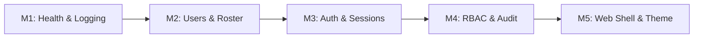
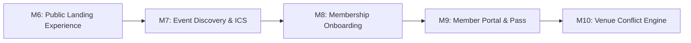
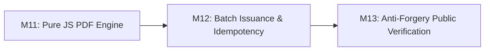
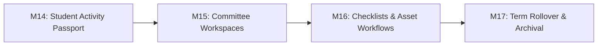

# CSI GCET SB Platform — Comprehensive Phase Explanation (PE.md)

---

## 1. Executive Overview & System Architecture

The **Computer Society of India G. H. Patel College of Engineering & Technology Student Branch (CSI GCET SB)** website and management platform is a high-reliability, security-first digital ecosystem designed to support chapter administration, academic event discovery, attendance tracking, verifiable credential issuance, and student governance.

### Architectural Philosophy
1. **Docker-Free, Local-First Reliability**: Pure Node.js and native PostgreSQL execution avoiding virtualization overhead and container deployment friction.
2. **Dual-Database Safety**: Strict separation between development (`csi_gcet_dev`) and test (`csi_gcet_test`) environments enforced by runtime guards (`TestDbGuard`).
3. **Shared Source of Truth**: All domain models, Zod validation schemas, error envelopes, and permission matrices reside in `@csi/shared` and are compiled to ESM/CJS/DTS before consumption by `@csi/api` and `@csi/web`.
4. **Deny-by-Default Authorization**: All backend routes require authentication unless explicitly decorated with `@Public()`. Permissions are re-evaluated per request against live PostgreSQL role assignments.
5. **Immutable Cryptographic Audit Trails**: All administrative, authentication, and state mutations generate append-only audit entries protected by database-level triggers.
6. **Permanent Single Light Theme**: Standardized on a high-contrast editorial university palette (`#f9fafb` canvas, `#ffffff` surface, `#2b3a8c` CSI indigo, `#c8402f` accent) compliant with WCAG 2.2 AA.

```mermaid
graph TD
    Client["Next.js 15 Web Client (apps/web)"] -->|HTTPS / REST / Cookies| API["NestJS 10 API Gateway (apps/api)"]
    API -->|Validation & Contracts| Shared["Shared Library (@csi/shared)"]
    Client -->|Validation & Contracts| Shared
    API -->|Connection Pool (DML)| DB[(PostgreSQL: csi_gcet_dev)]
    API -->|Isolated Test Runner| TestDB[(PostgreSQL: csi_gcet_test)]
    API -->|RFC 5545 Feeds| Calendar[External Calendar Clients / Outlook / GCal]
```

---

## Phase 0: Foundation Bootstrap

### Strategic Objective
Establish a clean, deterministic, multi-package monorepo workspace and prepare the underlying relational database infrastructure without reliance on Docker containers or untracked local scripts.

### Context & Historical Pitfalls Avoided
Legacy student society sites frequently suffered from undocumented environment setup, monolithic spaghetti architectures, and hardcoded credentials committed directly to version control. Phase 0 guarantees that any student maintainer can configure the project from scratch using standard command-line tools.

### Key Milestones & Capabilities
- **P0-01 to P0-03: Pre-Flight Tooling Verification**: Automated checks for Node.js (>= 20), npm (>= 10), PostgreSQL (>= 15), and Git.
- **P0-04 to P0-06: Database Role & Extension Initialization**: Creation of non-superuser database roles:
  - `csi_migrator`: Owns schemas and executes DDL migrations.
  - `csi_app`: Restricted runtime DML role (SELECT, INSERT, UPDATE, DELETE only).
  - PostgreSQL Extensions: `citext` (case-insensitive emails) and `btree_gist` (concurrency-safe exclusion constraints).
- **P0-07: Monorepo Scaffold**: Turborepo / npm workspaces configuration uniting `apps/api`, `apps/web`, and `packages/shared`.
- **P0-08 to P0-10: Root Command Tooling & First Administrator**:
  - Development tools: `gen:secrets`, `check:colors`, `check:contrast`, `check:content`, and `db:reset:dev`.
  - Secure CLI admin bootstrapping script (`scripts/bootstrap-admin.ts`) utilizing interactive prompts and password hashing.

---

## Phase 1: Trustworthy Base (Architecture, Identity, RBAC & Frontend Shell)

### Strategic Objective
Build the hardened core of the application: unified error handling, environment validation, live role-based access control, secure credential and session management, and the baseline web shell.



### Module Breakdown

#### Module M1: Errors, Environment, Logging & Health Consolidation
- **Uniform Error Envelope**: RFC 7807 inspired envelope structure (`{ error: { code, message, fields } }`) emitted by a global exception filter.
- **Fail-Fast Configuration**: Strict Zod-validated `env.ts` crashing application boot immediately upon missing or invalid environment variables.
- **Automated PII Redaction**: Pino structured logger automatically censoring sensitive tokens, cookies, passwords, and personal student numbers.
- **Liveness & Readiness Probes**: `/api/health` and `/api/health/ready` endpoints verifying database ping and pool health.

#### Module M2: Users, Roles, Committees, Role Assignments & Roster
- **Domain Identity Schema**: User model tracking enrollment numbers, department branch, academic year, and status (`pending`, `active`, `inactive`, `graduated`).
- **Academic Roster Validation**: Roster table (`roster_entries`) storing officially published institutional enrollment data to prevent unauthorized signups.
- **Committee Structure**: Database hierarchy mapping Core and Sub-core executives across six technical and operational committees.

#### Module M3: Authentication & Sessions
- **Memory-Hard Password Hashing**: Argon2id cryptographic hashing preventing offline brute-force attacks.
- **Stateful Database Sessions**: `sessions` table tracking user agents, client IPs, expiration dates, and revocation timestamps.
- **Secure Dual-Token Cookie Strategy**: HTTP-only, SameSite=Lax cookies with SHA-256 token fingerprinting.
- **Account Verification & Recovery**: Single-use hashed tokens for email verification (`verification_tokens`) and password resets (`password_reset_tokens`).

#### Module M4: RBAC, Guards & Immutable Audit Logging
- **Live Role Resolution**: Database-driven permission computation bypassing stale JWT role claims.
- **Global Defense-in-Depth**:
  - `DenyByDefaultGuard`: Closes all endpoints by default.
  - `CsrfGuard`: Enforces double-submit cookie validation (`csi_csrf` and `X-CSRF-Token`) on all state-mutating requests.
  - `RateLimiterService`: Sliding-window memory rate limiter defending against credential stuffing and brute-force attacks.
- **Immutable Audit Trail**: Append-only `audit_log` table with PostgreSQL database triggers preventing `UPDATE`, `DELETE`, and `TRUNCATE` operations.

#### Module M5: Web Base (Shell, Theme, Navigation & Auth UI)
- **Design System Implementation**: "Indigo Lattice" design tokens declared in `tokens.css` with 100% adherence to single permanent light mode.
- **Accessible Layout Shell**: Semantic header landmarks, responsive mobile navigation drawers, and skip-to-content links.
- **Auth Flow Views**: Production-ready pages for `/login`, `/register`, `/forgot-password`, `/reset-password`, `/verify-email`, and `/pending-approval`.
- **Client Auth Context**: React Context hydrating authentication state, handling login handshakes, and dynamically updating navigation menus.

---

## Phase 2: Public Experience & Branch Presence

### Strategic Objective
Present an editorial, high-performance public presence for the GCET Student Branch, provide frictionless event discovery, enforce concurrency-safe event registrations, and support automated calendar synchronization.



### Module Breakdown

#### Module M6: Public Landing & Hero Experience, Past Highlights
- **10-Section Editorial Thread**: Continuous single-page storytelling (`#hero`, `#about`, `#activities`, `#events`, `#highlights`, `#gallery`, `#team`, `#membership`, `#faq`, `#footer`).
- **Progress Tracking ("The Thread")**: Visual SVG timeline and vertical scroll progress indicator powered by native `IntersectionObserver`.
- **Interactive Hero Lattice**: Engineering matrix visual with subtle mouse tilt interaction and `prefers-reduced-motion` accessibility support.
- **Public Status API**: `GET /api/public/status` delivering live active member counts, event totals, and membership drive windows without exposing student PII.
- **Incremental Static Regeneration (ISR)**: Static rendering with 300s cache revalidation and Schema.org JSON-LD structured data.

#### Module M7: Event Discovery, Registration & Calendar/ICS Subscriptions
- **Event & Registration Models**: Relational schemas for `venues`, `events`, `registrations`, and `event_guests`.
- **Public Discovery Endpoints**:
  - `GET /api/events`: Advanced server-side filtering by category, timeline status (upcoming vs past), date bounds, and full-text search.
  - `GET /api/events/:slug`: Detailed public view calculating live remaining capacity and active registration windows.
- **Concurrency-Safe Capacity Enforcement**: Row-level locking via PostgreSQL `SELECT ... FOR UPDATE` ensuring simultaneous registration spikes never exceed venue seating limits.
- **Registration Workflows**:
  - Member 1-click registration linked to active session.
  - Guest registration capturing contact information and mandatory DPDP Act consent.
  - Automatic waitlist promotion: When an attendee cancels, the earliest waitlisted member or guest is automatically promoted within the same atomic transaction.
- **Calendar Feeds (RFC 5545)**:
  - `GET /api/events/:id/ics`: Single-event iCalendar file download.
  - `GET /api/events/calendar.ics` & `GET /api/calendar/feed.ics`: Dynamic feed subscribing external calendar software (Google Calendar, Apple Calendar, Outlook) to upcoming CSI GCET events.

#### Module M8: Membership Onboarding & Verification
- **Membership Drive Windows**: Database-driven management (`drive_windows`) allowing chapter executives to open or close recruitment windows.
- **Application Pipeline**: Multi-step registration matching student enrollment numbers against verified academic rosters.
- **Digital ID Card Issuance**: Generation of signed digital membership cards (`/api/me/id-card`) embedded with time-sensitive, rotating cryptographic QR passes.

#### Module M9: Member Portal & Dynamic Attendance Sessions
- **Member Dashboard (`/dashboard`)**: Student self-service area displaying active registrations, attendance percentages, and earned credentials.
- **Attendance Session Engine**: Organizers can open localized attendance sessions (`attendance_sessions`) bound to specific audiences (participants, volunteers, core).
- **Multi-Method Check-In**: Check-in via cryptographic dynamic QR scan, rotating 6-digit TOTP codes, or authorized manual volunteer override.
- **Offline Attendance Queue**: Client-side IndexedDB storage allowing volunteer scanners to record check-ins during network blackouts, reconciling upon reconnection with conflict detection.

#### Module M10: Venue Booking & Conflict Prevention
- **Campus Facility Registry**: Structured venue definitions with capacity thresholds, AV capabilities, and location links.
- **Mathematical Double-Booking Guard**: Native PostgreSQL GIST exclusion constraint (`EXCLUDE USING gist (venue_id WITH =, tstzrange(starts_at, ends_at, '[)') WITH &&)`) preventing scheduling overlaps at the database engine level.

---

## Phase 3: Certificates & Verifiable Credentials

### Strategic Objective
Deliver high-integrity, automated credential generation for workshop participants and event winners while providing public cryptographic verification to eliminate counterfeit paper certificates.



### Module Breakdown

#### Module M11: Pure JavaScript Certificate Template Engine
- **Headless Chrome Elimination**: Pure JavaScript rendering utilizing `pdf-lib`, `@pdf-lib/fontkit`, and `qrcode` to run reliably without Chromium dependencies.
- **Dynamic Merge Templates**: High-resolution vector templates interpolating attendee name, college enrollment number, event title, category, and date.
- **Institutional Seals & Signatures**: Cryptographically anchored digital signatures and authorized signatory vector graphics.

#### Module M12: Batch Certificate Generation & Idempotency
- **Background Job Execution**: Long-running certificate generation tasks dispatched via asynchronous background workers.
- **Strict Idempotency Guard**: `Idempotency-Key` tracking preventing double-issuance on mobile retries or browser reloads.
- **Attendance Verification Prerequisite**: Strict database validation ensuring certificates can only be generated for users with verified attendance records.

#### Module M13: Public Verification & Cryptographic Anti-Forgery
- **Public Verification Portal**: Accessible at `/verify/[code]` and `GET /api/verify/:code`.
- **High-Entropy Verification Codes**: Minimum 80 bits of cryptographic entropy (Crockford Base32) preventing brute-force enumeration.
- **Revocation Transparency**: Full support for certificate revocation with timestamped reasons displayed on the public verification page.

---

## Phase 4: Committee Workspaces & Activity Dossiers

### Strategic Objective
Empower student branch executives with structured operational tooling, task delegation boards, asset review pipelines, and exportable extracurricular achievement passports for campus placements.



### Module Breakdown

#### Module M14: Student Activity Passport & Extracurricular Dossier
- **Verified Student Extracurricular Passport**: Aggregate dossier compiling all verified workshop attendances, hackathon achievements, and committee responsibilities held throughout college tenure.
- **Placement & Higher Education PDF Export**: Digitally signed, tamper-evident PDF dossier with quick verification links for academic counselors and recruiters.

#### Module M15: Committee Workspaces & Role-Specific Shells
- **Dedicated Committee Hubs**: Tailored private workspaces for Technical, Content & Documentation, Design & Media, Public Relations, Motion & Cinematography, and Logistics & Operations.
- **Dual-Role Navigation**: Smooth context switcher for core members concurrently managing multiple committee assignments.

#### Module M16: Task Management, Checklists & Asset Workflows
- **Pre-Event Run Checklists**: Interactive checklists (`checklists`, `checklist_runs`) establishing clear ownership and sign-off accountability prior to event launches.
- **Media Asset Pipeline**: Asset submission and review tracking for posters, banners, and promotional copy before public release.

#### Module M17: Annual Term Rollover & Archival
- **Executive Transition Tool**: Automated mechanism closing active committee terms (`term_end`), transitioning graduating students to alumnus status, and seating new executive boards.
- **Historical Snapshot Preservation**: Immutable retention of past academic term achievements and historical audit logs.

---

## Phase 5: Production Hardening, DPDP Compliance & Handover

### Strategic Objective
Finalize operational resilience, conduct rigorous data protection audits in accordance with Indian privacy laws (DPDP Act 2023), perform automated backup recovery drills, and deliver student maintainer runbooks.

### Key Milestones & Capabilities
- **Module M18: Production Hardening & DPDP Privacy Audit**:
  - Strict data minimization audit ensuring no unnecessary student information is stored.
  - Dedicated photo consent tracking before displaying student photographs on public pages.
  - Automated guest data retention and anonymization jobs.
  - Implementation of rate-limiting tiers using `@nestjs/throttler` across public, authentication, and attendance endpoints.
- **Module M19: Backup Drills, Runbook & Maintainer Handover**:
  - Automated `pg_dump` backup scripts with encryption and verified off-host replication.
  - Non-destructive automated restore drills (`scripts/restore-drill.mjs`) executing against scratch databases.
  - Comprehensive `RUNBOOK.md` detailing disaster recovery, SSL maintenance, environment rotation, and incident escalation protocols for incoming student branch webmasters.

---

## 2. Milestone Roadmap & Implementation Matrix

| Phase | Milestone / Module | Primary Domain | Core Deliverable | Verification Standard | Current Status |
| :--- | :--- | :--- | :--- | :--- | :--- |
| **Phase 0** | **P0-01 – P0-10** | Infrastructure | Docker-free setup, DB roles, root scripts, admin bootstrap | `test-migration-lifecycle.ts`, `db:reset:dev` | **100% Complete & Published** |
| **Phase 1** | **Module M1** | Core API | Unified error envelope, Zod env config, Pino logging, Health checks | Unit & E2E tests (`app.e2e-spec.ts`) | **100% Complete & Published** |
| **Phase 1** | **Module M2** | Identity & Roster | User models, status transitions, roles, committees, academic roster | Unit tests, relational constraints | **100% Complete & Published** |
| **Phase 1** | **Module M3** | Security & Auth | Argon2id hashing, stateful sessions, dual cookies, email tokens | E2E auth tests (`auth.e2e-spec.ts`) | **100% Complete & Published** |
| **Phase 1** | **Module M4** | Governance | Dynamic RBAC, DenyByDefaultGuard, CsrfGuard, append-only audit log | Integration tests, PostgreSQL trigger test | **100% Complete & Published** |
| **Phase 1** | **Module M5** | Web Shell | Next.js 15 App Router, Light theme tokens, Navigation, Auth UI | Static prerendering, WCAG 2.2 AA contrast | **100% Complete & Published** |
| **Phase 2** | **Module M6** | Public Landing | 10-section landing page, ISR (300s), Thread indicator, Hero lattice | Next.js build prerender, color/contrast scan | **100% Complete & Published** |
| **Phase 2** | **Module M7** | Events & Calendar | Event discovery, Concurrency-safe registration, RFC 5545 ICS feeds | Unit tests, concurrency simulation, ICS parser | **100% Complete & Published** |
| **Phase 2** | **Module M8** | Membership | Drive window toggles, application review, digital ID QR pass | QR signing test, status lifecycle test | **100% Complete & Verified** |
| **Phase 2** | **Module M9** | Member Portal | Self-service dashboard, Dynamic check-in sessions, Offline queue | Offline sync reconciliation, TOTP checks | **100% Complete & Verified** |
| **Phase 2** | **Module M10** | Venue Engine | Facility registry, PostgreSQL GIST exclusion constraint | GIST overlap test (`23P01` conflict code) | Scheduled |
| **Phase 3** | **Module M11** | Credentials | Pure JS PDF template engine (`pdf-lib`), vector merge engine | PDF render fidelity, fontkit embed test | Scheduled |
| **Phase 3** | **Module M12** | Batch Issuance | Background job processing (pg-boss), Idempotency-Key guard | Idempotency replay test, attendance gate test | Scheduled |
| **Phase 3** | **Module M13** | Verification | Public verification portal (`/verify/[code]`), base32 codes | Rate limit test, revocation state test | Scheduled |
| **Phase 4** | **Module M14** | Dossiers | Verified Student Activity Passport, career dossier PDF export | SHA-256 tamper verification, QR verify test | Scheduled |
| **Phase 4** | **Module M15** | Workspaces | Committee workspaces, dual-role context switcher | Role scope authorization test | Scheduled |
| **Phase 4** | **Module M16** | Operations | Event run checklists, media asset review pipeline | Signed checklist run test, asset upload gate | Scheduled |
| **Phase 4** | **Module M17** | Rollover | Annual executive rollover, historical snapshot preservation | Term expiration test, snapshot integrity test| Scheduled |
| **Phase 5** | **Module M18** | Privacy & Polish| DPDP Act 2023 audit, data minimization, IP rate limiting tiers | DPDP policy scan, load/rate limit test | Scheduled |
| **Phase 5** | **Module M19** | Handover | Backup restoration drills, Runbook documentation, student training | `restore-drill.mjs` execution, zero defect pass| Scheduled |

---

*This document serves as the permanent architectural roadmap and milestone index for the CSI GCET Student Branch web platform.*
