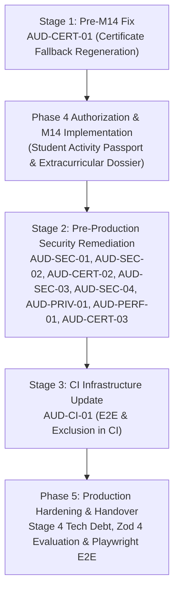

# Audit Remediation Plan
## CSI GCET Student Branch Platform
**Audit Phase:** Post-Phase 3, Pre-Phase 4 (M14)  
**Date:** October 31, 2026  
**Auditor:** Application Security Engineer & Systems Architect  

---

## 1. Remediation Strategy Overview

This remediation plan organizes the 13 findings identified in the comprehensive post-Phase 3 technical audit into four prioritized execution stages:

1. **Pre-M14 Fixes:** Required before commencing Module M14 (Student Activity Passport & Extracurricular Dossier) because M14 builds directly on verifiable credential records.
2. **Pre-Production Security & Data Protection Fixes:** Required before production launch to satisfy security, authorization, and data privacy baselines.
3. **CI & Operational Hardening:** Toolchain, testing, and continuous integration pipeline updates.
4. **Technical Debt & Phase 5 Hardening:** Non-blocking quality enhancements and framework upgrade planning.

---

## 2. Prioritized Remediation Stages

### Stage 1: Pre-M14 Fixes (Blocking Module M14) — COMPLETED

| Finding ID | Title | Component | Complexity | Status | Resolution |
|---|---|---|:---:|:---:|---|
| **AUD-CERT-01** | Fix Certificate Fallback Regeneration & Verification Binding | `CertificateIssuanceService.getCertificateDownload` | Low | **Resolved** | Option A implemented: fail safely on missing/corrupt files with HTTP 409 `CERTIFICATE_FILE_UNAVAILABLE` or `CERTIFICATE_INTEGRITY_MISMATCH`. Zero unverified PDF regeneration. |

#### Implementation & Verification for AUD-CERT-01:
1. **Root Cause Analysis:** `getCertificateDownload()` regenerated the PDF using `certData`, but omitted `verification_code` and `verification_url` because only `verificationCodeHash` was stored in the database. The regenerated PDF had a divergent SHA-256 hash and broke public verification.
2. **Remediation Strategy:** Implemented Option A (Fail Safely When an Issued Certificate File Is Missing).
   - Removed unsafe automatic regeneration fallback.
   - Missing disk files trigger HTTP 409 Conflict with standard error code `CERTIFICATE_FILE_UNAVAILABLE`.
   - Files with checksum mismatches trigger HTTP 409 Conflict with standard error code `CERTIFICATE_INTEGRITY_MISMATCH`.
   - Preserved authorization checks prior to filesystem checks.
   - Preserved HTTP 404 Not Found for nonexistent certificates.
   - Added standard error codes to `@csi/shared`.
   - Logging audited: no student PII or internal server filesystem paths exposed.
3. **Verification Gate Passed:** Verified via unit tests (`certificate-batch.service.spec.ts`) and E2E tests (`certificate-batch.e2e-spec.ts`). Full test suites pass cleanly (284 unit tests, 77 E2E tests). Pre-M14 gate satisfied.

---

### Stage 1.5: Module M14 Post-Implementation Hardening — COMPLETED

Completed during the post-implementation audit of Module M14 (Student Activity Passport & Extracurricular Dossier):

| Finding ID | Title | Component | Complexity | Status | Resolution |
|---|---|---|:---:|:---:|---|
| **AUD-SEC-01** / **M14-AUD-03** | Replace Raw `X-Forwarded-For` with Sanitized `req.ip` | `PublicVerificationRateLimitGuard`, `PublicVerificationController`, `PassportsController` | Low | **Resolved** | Replaced manual `split(',')[0]` header extraction with Express-sanitized `req.ip`. E2E tested against rotating spoofed headers. |
| **M14-AUD-02** | Unified Public Verification Route for Passports and Certificates | `PublicVerificationController` | Low | **Resolved** | Injected `PassportVerificationService` via `forwardRef`; route automatically verifies certificates first, then passports. |
| **M14-AUD-04** | Enriched Historical Activity Snapshot & Superseded Passport Invalidation | `PassportExportService`, `PassportVerificationService` | Medium | **Resolved** | `summaryJson` captures both metrics and full item snapshots; exporting new passport transitions previous ones to `superseded`. |
| **M14-AUD-05** | Canonical Committee Role Validation & Future Tenure Exclusion | `PassportAggregationService` | Low | **Resolved** | Enforced canonical `RoleCode` enums, filtered `termStart <= now`, and deduplicated recurring tenures by year. |
| **M14-AUD-06** | Post-Issuance Revocation Advisory on Underlying Snapshot Credentials | `PassportVerificationService` | Low | **Resolved** | Verification inspects underlying snapshot certificate statuses and emits advisory notice if any have been revoked. |

---

### Stage 2: Pre-Production Security & Authorization Fixes

Must be completed prior to deploying the platform to production or admitting real GCET students:

| Finding ID | Title | Component | Complexity | Status | Remediation Action |
|---|---|---|:---:|:---:|---|
| **AUD-SEC-01** | Replace Raw `X-Forwarded-For` with Sanitized `req.ip` | `PublicVerificationRateLimitGuard`, `PublicVerificationController` | Low | **Resolved** | Resolved during M14 Audit Hardening (see Stage 1.5 above). |
| **AUD-SEC-02** | Secure `POST /api/id-card/verify` with Authentication & Rate Limiting | `IdCardController.verifyQrPass` | Low | Confirmed | Remove `@Public()`. Require `@Authenticated()` and `@RequirePermission(PermissionCode.ATTENDANCE_MARK)`. Add `this.rateLimiter.assertLimit('verify-qr-pass:' + ip, 60, 60000)`. |
| **AUD-CERT-02** | Enforce Request Hash Matching & Expiration on Idempotency Keys | `CertificateIssuanceService.issueBatch` | Medium | Confirmed | In `issueBatch()`, compare `existingKey.requestHash === currentRequestHash`. If different, throw HTTP 422 `IDEMPOTENCY_PAYLOAD_MISMATCH`. Verify `existingKey.expiresAt > new Date()`. Reserve the key atomically at the start of the batch transaction. |
| **AUD-SEC-03** | Migrate Dynamic QR Pass from HMAC-SHA256 to Ed25519 Asymmetric Signatures | `IdCardService.getIdCard`, `IdCardService.verifyQrPass` | Medium | Confirmed | Use Node's native `crypto.sign('ed25519', ...)` with `QR_SIGNING_PRIVATE_KEY` for generation, and `crypto.verify('ed25519', ...)` with `QR_SIGNING_PUBLIC_KEY` for verification. Remove the hardcoded fallback string. |
| **AUD-SEC-04** | Encrypt Attendance TOTP Secrets at Rest with AES-256-GCM | `AttendanceService` | Medium | Confirmed | Encrypt `session.totpSecret` using `APP_ENCRYPTION_KEY` before storing in `attendance_sessions`. Decrypt only during code verification. |
| **AUD-PRIV-01** | Implement Automated Retention Schedules & Expired Token Purging | API Scheduled Worker / SQL Procedure | Medium | Confirmed | Create a lightweight scheduled task to delete expired `sessions`, `verification_tokens`, `password_reset_tokens`, and `idempotency_keys`. Anonymize `audit_log.ip` older than 90 days. |
| **AUD-PERF-01** | Implement In-Memory Rate Limiter Eviction & Multi-Instance Preparation | `RateLimiterService` | Low | Confirmed | Add periodic TTL key cleanup interval to `RateLimiterService.store` to prevent unbounded memory growth. |
| **AUD-CERT-03** | Add Zombie Batch Crash Recovery | `CertificateBatchProcessorService` | Low | Confirmed | Allow `retryBatch()` to recover batches stuck in `processing` state for longer than 30 minutes. |

---

### Stage 3: CI & Continuous Integration Hardening

| Finding ID | Title | Component | Complexity | Remediation Action |
|---|---|---|:---:|---|
| **AUD-CI-01** | Add E2E and Venue Exclusion Suites to GitHub Actions CI | `.github/workflows/ci.yml` | Low | Add `npm run test:e2e --prefix apps/api` and `npx tsx scripts/validation/test-venue-exclusion.ts` to CI. Configure `npm audit --omit=dev --audit-level=critical` to handle deferred Zod advisory gracefully. |

---

### Stage 4: Technical Debt & Phase 5 Hardening

| Finding ID | Title | Component | Complexity | Remediation Action |
|---|---|---|:---:|---|
| **AUD-TEST-01** | Frontend Component & E2E Testing | `apps/web` | Medium | Introduce Playwright E2E tests for primary member flows (landing, auth, registration, verification, scanner). |
| **AUD-DATA-01** | Clean Handling of Malformed Offline Sync Clock Skew | `AttendanceService` | Low | Handle missing `member_id` without inserting a shared static dummy UUID. |
| **AUD-DEP-01** | Zod 4 Framework Migration Evaluation | Monorepo root | High | Evaluate Zod v4 migration during Phase 5 (Production Hardening) with dedicated schema regression testing. |

---

## 3. Recommended Execution Sequence

---

## 4. Immediate Next Action

1. Present the Comprehensive Audit Report and Audit Findings to the Project Lead / User.
2. Await decision on `AUD-CERT-01`: Resolve `AUD-CERT-01` via a targeted Pre-M14 fix or acknowledge its constraint prior to starting Phase 4 (Module M14).
3. Do not proceed to M14 implementation until authorized.
