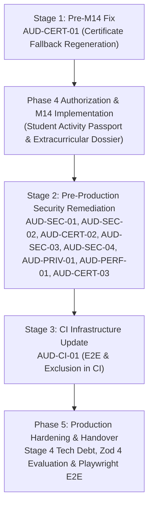

# Audit Remediation Plan
## CSI GCET Student Branch Platform
**Audit Phase:** Post-Phase 3, Pre-Phase 4 (M14)  
**Date:** October 31, 2026  
**Auditor:** Application Security Engineer & Systems Architect  

---

## 1. Remediation Strategy Overview

This remediation plan organizes the 13 findings identified in the comprehensive post-Phase 3 technical audit into four prioritized execution stages:

1. **Pre-M14 Fixes:** Required before commencing Module M14 (Student Activity Passport & Extracurricular Dossier) because M14 builds directly on verifiable credential records.
2. **Pre-Production Security & Data Protection Fixes:** Required before production launch to satisfy security, authorization, and data privacy baselines.
3. **CI & Operational Hardening:** Toolchain, testing, and continuous integration pipeline updates.
4. **Technical Debt & Phase 5 Hardening:** Non-blocking quality enhancements and framework upgrade planning.

---

## 2. Prioritized Remediation Stages

### Stage 1: Pre-M14 Fixes (Blocking Module M14)

| Finding ID | Title | Component | Complexity | Risk if Unaddressed |
|---|---|---|:---:|---|
| **AUD-CERT-01** | Fix Certificate Fallback Regeneration & Verification Binding | `CertificateIssuanceService.getCertificateDownload` | Low | If an issued certificate file is missing from disk, member self-service download regenerates a PDF that lacks the QR code and permanently fails public verification with `INTEGRITY_MISMATCH`. |

#### Implementation Plan for AUD-CERT-01:
1. **Root Cause Analysis:** `getCertificateDownload()` regenerates the PDF using `certData`, but omits `verification_code` and `verification_url` because only `verificationCodeHash` was stored in the database.
2. **Remediation Options:**
   - *Option A (Recommended for Pre-M14):* In `CertificateStorageService.saveCertificatePdf()`, ensure certificates are persisted reliably to non-volatile storage. If `storagePath` exists in the database, verify that the file exists before attempting download. If the file is missing from disk, rather than rendering an incomplete PDF that breaks the cryptographic integrity hash, return an explicit error (HTTP 404 or 409 `CERTIFICATE_FILE_UNAVAILABLE`) alerting administrators to re-issue or restore from backup.
   - *Option B (Full Cryptographic Regeneration):* Store the encrypted raw verification code in `Certificate.metadata` (encrypted with `APP_ENCRYPTION_KEY`). On fallback regeneration, decrypt the verification code, render the exact QR badge, and update `Certificate.fileHash` transactionally with an audit log record.
3. **Verification Gate:** Test that regenerating or downloading an issued certificate with a missing disk file never outputs a certificate that fails public verification.

---

### Stage 2: Pre-Production Security & Authorization Fixes

Must be completed prior to deploying the platform to production or admitting real GCET students:

| Finding ID | Title | Component | Complexity | Remediation Action |
|---|---|---|:---:|---|
| **AUD-SEC-01** | Replace Raw `X-Forwarded-For` with Sanitized `req.ip` | `PublicVerificationRateLimitGuard`, `PublicVerificationController` | Low | Replace manual `req.headers['x-forwarded-for'].split(',')[0]` with Express-sanitized `req.ip`. Express correctly evaluates trusted hops via `TRUST_PROXY_HOPS`. |
| **AUD-SEC-02** | Secure `POST /api/id-card/verify` with Authentication & Rate Limiting | `IdCardController.verifyQrPass` | Low | Remove `@Public()`. Require `@Authenticated()` and `@RequirePermission(PermissionCode.ATTENDANCE_MARK)`. Add `this.rateLimiter.assertLimit('verify-qr-pass:' + ip, 60, 60000)`. |
| **AUD-CERT-02** | Enforce Request Hash Matching & Expiration on Idempotency Keys | `CertificateIssuanceService.issueBatch` | Medium | In `issueBatch()`, compare `existingKey.requestHash === currentRequestHash`. If different, throw HTTP 422 `IDEMPOTENCY_PAYLOAD_MISMATCH`. Verify `existingKey.expiresAt > new Date()`. Reserve the key atomically at the start of the batch transaction. |
| **AUD-SEC-03** | Migrate Dynamic QR Pass from HMAC-SHA256 to Ed25519 Asymmetric Signatures | `IdCardService.getIdCard`, `IdCardService.verifyQrPass` | Medium | Use Node's native `crypto.sign('ed25519', ...)` with `QR_SIGNING_PRIVATE_KEY` for generation, and `crypto.verify('ed25519', ...)` with `QR_SIGNING_PUBLIC_KEY` for verification. Remove the hardcoded fallback string. |
| **AUD-SEC-04** | Encrypt Attendance TOTP Secrets at Rest with AES-256-GCM | `AttendanceService` | Medium | Encrypt `session.totpSecret` using `APP_ENCRYPTION_KEY` before storing in `attendance_sessions`. Decrypt only during code verification. |
| **AUD-PRIV-01** | Implement Automated Retention Schedules & Expired Token Purging | API Scheduled Worker / SQL Procedure | Medium | Create a lightweight scheduled task to delete expired `sessions`, `verification_tokens`, `password_reset_tokens`, and `idempotency_keys`. Anonymize `audit_log.ip` older than 90 days. |
| **AUD-PERF-01** | Implement In-Memory Rate Limiter Eviction & Multi-Instance Preparation | `RateLimiterService` | Low | Add periodic TTL key cleanup interval to `RateLimiterService.store` to prevent unbounded memory growth. |
| **AUD-CERT-03** | Add Zombie Batch Crash Recovery | `CertificateBatchProcessorService` | Low | Allow `retryBatch()` to recover batches stuck in `processing` state for longer than 30 minutes. |

---

### Stage 3: CI & Continuous Integration Hardening

| Finding ID | Title | Component | Complexity | Remediation Action |
|---|---|---|:---:|---|
| **AUD-CI-01** | Add E2E and Venue Exclusion Suites to GitHub Actions CI | `.github/workflows/ci.yml` | Low | Add `npm run test:e2e --prefix apps/api` and `npx tsx scripts/validation/test-venue-exclusion.ts` to CI. Configure `npm audit --omit=dev --audit-level=critical` to handle deferred Zod advisory gracefully. |

---

### Stage 4: Technical Debt & Phase 5 Hardening

| Finding ID | Title | Component | Complexity | Remediation Action |
|---|---|---|:---:|---|
| **AUD-TEST-01** | Frontend Component & E2E Testing | `apps/web` | Medium | Introduce Playwright E2E tests for primary member flows (landing, auth, registration, verification, scanner). |
| **AUD-DATA-01** | Clean Handling of Malformed Offline Sync Clock Skew | `AttendanceService` | Low | Handle missing `member_id` without inserting a shared static dummy UUID. |
| **AUD-DEP-01** | Zod 4 Framework Migration Evaluation | Monorepo root | High | Evaluate Zod v4 migration during Phase 5 (Production Hardening) with dedicated schema regression testing. |

---

## 3. Recommended Execution Sequence

---

## 4. Immediate Next Action

1. Present the Comprehensive Audit Report and Audit Findings to the Project Lead / User.
2. Await decision on `AUD-CERT-01`: Resolve `AUD-CERT-01` via a targeted Pre-M14 fix or acknowledge its constraint prior to starting Phase 4 (Module M14).
3. Do not proceed to M14 implementation until authorized.
