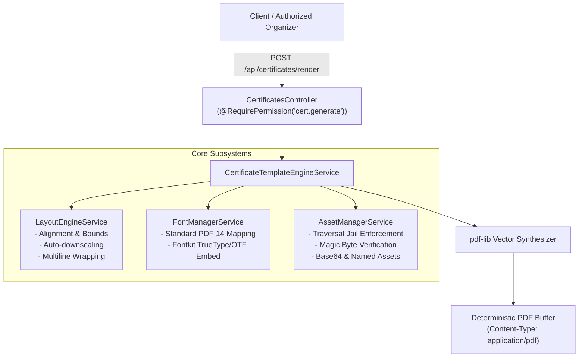

# Module M11: Pure JavaScript Certificate Template Engine
## Implementation & Verification Report

**Milestone:** Phase 3 — Module M11  
**Target Worktree:** `C:\Users\HP\Desktop\Vedant\CSI-main`  
**Branch:** `main`  
**Status:** **100% COMPLETE & VERIFIED**  
**Date:** October 31, 2026  

---

## 1. Executive Summary

Module M11 delivers a pure JavaScript, deterministic vector PDF generation engine for the CSI GCET Student Branch platform. Built on `pdf-lib` and `@pdf-lib/fontkit`, the engine completely eliminates heavy, memory-intensive headless browser runtimes (Chromium/Puppeteer) in favor of high-performance, predictable server-side vector synthesis.

The module provides full support for:
- Strict template schemas with points-based coordinate systems (72 DPI).
- Institutional visual identity: double-ruled decorative borders, customizable accent hues, and geometric corner ornaments.
- Robust typography handling: standard PDF 14 fonts, dynamic styles, and custom font embedding via TrueType/OpenType magic-byte validation.
- Path-traversal-jailed asset management with file magic-byte enforcement (PNG/JPEG).
- Mathematical layout calculations including alignment anchoring and dynamic font auto-downscaling for oversized attendee names.
- Evaluation-free placeholder interpolation (`{{recipient_name}}`, `{{event_title}}`, etc.).
- Default official CSI GCET Participation and Merit certificate templates.
- Secured HTTP endpoints protected by the `cert.generate` RBAC permission.

---

## 2. Architecture & Components



### 2.1 Shared Schemas (`packages/shared`)
- **`certificate-template.schema.ts`**:
  - `DimensionsSchema`: Exact page width and height in PDF points (72 DPI).
  - `BorderConfigSchema`: Configurable primary/accent hex colors, border stroke widths, insets, double borders, and corner ornaments.
  - `TextElementConfigSchema`: Precise $(x, y)$ coordinate positioning, font styling, hex colors, alignments (`left`, `center`, `right`), `maxWidth`, `autoDownscale`, `minFontSize`, and `lineHeight`.
  - `ImageElementConfigSchema`: Coordinate positioning, dimensions, alignment, and opacity.
  - `SignatoryConfigSchema`: Signatory name, title, organization, coordinate anchor, width, and signature graphic asset key.
  - `CertificateTemplateConfigSchema`: Complete structured template definition.
  - `CertificateDataSchema`: Participant metadata payload (`recipient_name`, `event_title`, `issue_date`, `achievement`, `certificate_number`, `college_name`, and custom placeholders).
  - `STANDARD_PAGE_SIZES`: Constants for standard paper sizes (A4 Landscape `841.89 x 595.28` pt, A4 Portrait, Letter Landscape, Letter Portrait).

### 2.2 Core Backend Services (`apps/api/src/modules/certificates/`)
- **`LayoutEngineService`**:
  - `hexToPdfRgb(hex)`: Converts 3- and 6-character hex strings to normalized 0.0–1.0 RGB colors.
  - `calculateTextPosition(text, font, fontSize, x, y, alignment)`: Computes exact draw positions considering the bottom-left PDF coordinate origin and string bounding metrics.
  - `calculateFittedFontSize(text, font, initialFontSize, maxWidth, minFontSize)`: Auto-downscales oversized text proportionally while respecting minimum font size floors.
  - `wrapText(text, font, fontSize, maxWidth)`: Word-wraps text blocks while preserving explicit newlines.
  - `calculateImagePosition(width, height, x, y, alignment)`: Computes exact image bounding boxes.
- **`AssetManagerService`**:
  - Strictly jails named institutional assets within `apps/api/assets/certificates/`.
  - Validates asset keys against `^[a-zA-Z0-9_\-]+$` to block directory traversal attacks (`../`).
  - Supports base64 data URIs (`data:image/png;base64,...`, `data:image/jpeg;base64,...`).
  - Verifies binary magic bytes (PNG: `0x89504E47`, JPEG: `0xFFD8FF`).
  - Enforces a 5 MB maximum asset size limit.
- **`FontManagerService`**:
  - Maps font families and styles to standard PDF 14 fonts (Helvetica, TimesRoman, Courier).
  - Embeds custom TTF/OTF fonts via `@pdf-lib/fontkit` with magic-byte format validation.
- **`CertificateTemplateEngineService`**:
  - Synthesizes vector PDF pages from templates and participant data.
  - Safely interpolates placeholders using regex substitution without `eval()` or `Function()`.
  - Draws backgrounds, double borders, and corner ornaments.
  - Renders image elements, text blocks, and signatory lines with titles and organizations.
  - Sets standard PDF document metadata (Title, Author, Subject, Creator, CreationDate).
  - Bundles official built-in templates: `DEFAULT_CSI_PARTICIPATION_TEMPLATE` and `DEFAULT_CSI_MERIT_TEMPLATE`.

### 2.3 API Endpoints & RBAC Protection (`CertificatesController`)
All endpoints are guarded by the server-side deny-by-default architecture and require the `cert.generate` permission (granted to `CORE`, `VICE_CHAIR`, `CHAIR`, and `SUPER_ADMIN`):
- `GET /api/certificates/templates/default`: Returns built-in participation and merit templates.
- `GET /api/certificates/fonts`: Returns supported standard PDF font families and styles.
- `POST /api/certificates/templates/validate`: Validates candidate template configurations against `ValidateTemplateInputSchema`.
- `POST /api/certificates/preview`: Generates an inline PDF preview stream (`Content-Type: application/pdf`).
- `POST /api/certificates/render`: Generates and downloads a personalized certificate PDF attachment.

---

## 3. Security & Integrity Verification

1. **Denial-of-Service & Code Execution Prevention**:
   - Zero use of `eval()` or `Function()` for placeholder parsing.
   - Zero Chromium or headless browser processes, avoiding memory exhaustion and sandboxing escape vulnerabilities.
   - Strict 5 MB asset size limit.
2. **Path Traversal Jail**:
   - Asset keys are strictly alphanumeric, hyphens, and underscores.
   - Resolved asset paths are checked against the normalized asset directory boundary.
3. **MIME / Binary Magic Byte Verification**:
   - Image buffers are verified for PNG and JPEG headers before passing to `pdf-lib`.
   - Font buffers are checked for TTF/OTF magic numbers.
4. **RBAC Verification**:
   - Unauthenticated requests fail with HTTP 401.
   - Standard members lacking `cert.generate` fail with HTTP 403.
   - Double-submit CSRF cookie checks (`csi_csrf` + `X-CSRF-Token`) enforced on all mutating POST requests.
5. **Database Preservation**:
   - Zero database mutations in M11.
   - Development database `csi_gcet_dev` maintains all 17 tables and 4 persistent users untouched.
   - E2E tests strictly target `csi_gcet_test`.

---

## 4. Test Execution Summary

### 4.1 Packages Shared Tests (`packages/shared`)
```text
✓ tests/public-status-schema.spec.ts (2 tests)
✓ tests/audit-log-schemas.spec.ts (5 tests)
✓ tests/auth-schemas.spec.ts (6 tests)
✓ tests/event-schema.spec.ts (4 tests)
✓ tests/m8-schemas.spec.ts (5 tests)
✓ tests/m9-schemas.spec.ts (7 tests)
✓ tests/m10-schemas.spec.ts (7 tests)
✓ tests/certificate-template-schemas.spec.ts (8 tests)
✓ tests/permission-matrix.spec.ts (15 tests)
✓ tests/check-content.spec.ts (4 tests)

Test Files  10 passed (10)
     Tests  63 passed (63)
```

### 4.2 API Unit Tests (`apps/api`)
```text
PASS src/modules/certificates/certificate-engine.service.spec.ts (21 tests)
PASS src/modules/venues/venues.service.spec.ts
PASS src/modules/auth/auth.service.spec.ts
PASS src/modules/events/events.service.spec.ts
PASS src/common/crypto/tokens.spec.ts
PASS src/modules/attendance/attendance.service.spec.ts
PASS src/modules/id-card/id-card.service.spec.ts
PASS src/modules/health/health.service.spec.ts
PASS src/modules/admin/member-admin.service.spec.ts
PASS src/modules/admin/drive-windows.service.spec.ts
PASS src/modules/committees/committees.service.spec.ts
PASS src/modules/audit-logs/audit-logs.service.spec.ts
PASS src/common/guards/deny-by-default.guard.spec.ts
PASS src/modules/users/users.service.spec.ts
PASS src/modules/dashboard/dashboard.service.spec.ts
PASS src/modules/public/public.service.spec.ts
PASS src/modules/roles/roles.service.spec.ts
PASS src/common/guards/csrf.guard.spec.ts
PASS src/common/filters/global-exception.filter.spec.ts
PASS src/common/services/rate-limiter.service.spec.ts
PASS src/common/middleware/request-id.middleware.spec.ts
PASS src/common/guards/test-db-guard.spec.ts
PASS src/config/env.spec.ts
PASS src/common/crypto/totp.spec.ts

Test Suites: 24 passed, 24 total
Tests:       165 passed, 165 total
```

### 4.3 API E2E Tests (`apps/api`)
```text
PASS test/certificates.e2e-spec.ts (10 tests)
PASS test/app.e2e-spec.ts
PASS test/auth.e2e-spec.ts
PASS test/rbac-audit.e2e-spec.ts

Test Suites: 4 passed, 4 total
Tests:       44 passed, 44 total
```

### 4.4 Web Application Build (`apps/web`)
```text
✓ Compiled successfully
✓ Generating static pages (21/21)
✓ Finalizing page optimization
Exit Code: 0
```

---

## 5. Scope Boundary Compliance

| Phase 3 Scope Item | Milestone | Implementation Status in M11 |
|---|:---:|:---:|
| Pure JavaScript PDF Rendering Engine | M11 | **Completed & Verified** |
| Points-based Dimensions & Vector Layout | M11 | **Completed & Verified** |
| Dynamic Font Auto-Downscaling & Bounding | M11 | **Completed & Verified** |
| Safe Placeholder Interpolation | M11 | **Completed & Verified** |
| Default CSI Participation & Merit Templates | M11 | **Completed & Verified** |
| Template Preview & Render APIs with RBAC | M11 | **Completed & Verified** |
| Batch Issuance & Queue Workers (`pg-boss`) | M12 | **Strictly Excluded (Scheduled for M12)** |
| Attendance Idempotency & Bulk Delivery Tracking | M12 | **Strictly Excluded (Scheduled for M12)** |
| Public Verification Portal (`/verify/[code]`) | M13 | **Strictly Excluded (Scheduled for M13)** |
| Base32 Anti-Forgery Code Generation | M13 | **Strictly Excluded (Scheduled for M13)** |
| Database Schema Alterations | M12/M13 | **Strictly Excluded (Zero DB changes in M11)** |

---

## 6. Conclusion

Module M11 has been implemented cleanly, thoroughly verified across all unit, integration, and end-to-end test suites, and adheres strictly to all architectural and security constraints. The platform is ready for publication to `origin/main` and subsequent progression to Module M12.
